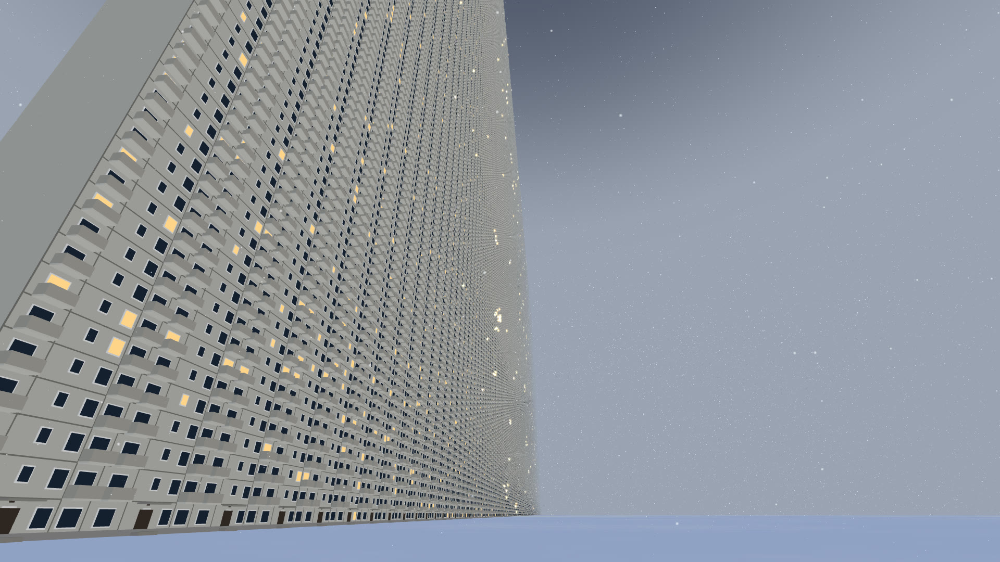

# Example: five sessions draw one picture

A whole fleet run, small enough to repeat in an hour: one task, five Claude Code sessions, one picture. The picture
is a khrushchevka - a Soviet five-storey panel block - grown to the size of a megastructure, in winter. The scene
is three.js, drawn once by headless Chromium and saved as a PNG.

This directory holds the project as the fleet received it, what the fleet made of it, and how to run it yourself.

| directory | what it is |
|---|---|
| `start/` | the repository the fleet was given: two placeholder parts, one test, a render script |
| `result/` | the four files the fleet wrote or changed, and the picture it handed over (as a JPEG) |

`start/` with `result/src` and `result/test` copied over it is the code on the fleet's trunk, file for file. The
trunk also carried flotilla's own `.flotilla/` and the plugin's line in `.claude/settings.json`.

## The run that produced this

flotilla 0.13.0, Claude Code 2.1.296, Linux, 2026-10-12. One orchestrator, two main sessions, one reviewer, one
sender; all on Sonnet, permission mode `auto`, every branch reviewed, the sender merges directly. The person typed
four messages: the task, a stop and a rule (below, under "What went wrong"), and the acceptance.

The work became five rows in the ledger, four of which reached trunk. Minutes are counted from the task.

| minute | what happened |
|---|---|
| 0 | the task is typed to the orchestrator; half a minute later two rows are claimed, the building and the winter |
| 4-9 | the building's first render on the rented GPU fails: the page cannot load a module the Node test loaded fine. Fixed, rendered green |
| 7 | the winter is handed to the reviewer |
| 16 | the building is handed over. A third row is opened: the winter's lit windows do not sit on the building's windows. The winter's author merges the building's branch and moves them |
| 30 | the reviewer accepts the building, and returns the winter with three points (below) |
| 35-43 | the winter comes back fixed, is accepted over that exact revision and landed; the third row is released, its work being in the winter's |
| 43-48 | a row nobody asked for: the camera stood too far away to read a window. A new view is built, reviewed and landed |
| 47-52 | a fifth row, the fog for that view, is built |
| 52-64 | the fog is with the reviewer, whose render of it sits ten minutes in the jam described under "What went wrong" |
| 64 | the fog is accepted and landed |
| 65 | trunk is rendered once more; the orchestrator reports the picture and its flaws |

The commits the fleet put on trunk, oldest first, merges left out:

    f7ca614 feat: the building - a khrushchevka scaled to 300 storeys by 250 entrance sections, instanced
    f2cfeba fix: the building merges its own boxes - the page serves only three's build
    9c3b81d feat: the winter - snow ground, dusk sky, fog, snowfall, soft light, lit windows as glows
    34571ab feat: the lit-window glows sit on the building's real window grid; fog clears to the near wall
    f4698cd fix: stable hash and fading fine octaves in the snow; low haze in the sky; fog reaches full before the wall's far end
    bcb8323 feat: the camera stands off the end of the wall and looks along its front; fog laid out for that view
    94ed0b2 fix: the far end dissolves into the haze; glows dim by the fog as rendered and are capped in size; snowfall follows the framing camera
    3af69f8 fix: haze reaches higher in the sky, glows dim with the square of the fog's clearness

### The return

The two main sessions wrote their parts apart: one owned the building, the other the weather and the lit windows.
The reviewer read both branches, looked at a render of each, and sent the winter back with three points:

1. the lit windows were laid on a grid of their own (3.0 m a storey) and missed the building's real windows
   (2.7 m a storey) - the fleet had opened a row for exactly this fourteen minutes earlier;
2. the snow showed hard-edged rectangular patches: the noise broke up at kilometre coordinates;
3. the fog did not swallow the far end of the wall, which the task asked for.

Tests were green on that branch the whole time. All three were the picture's problems, and they show only in a
render.

### What the fleet said was still wrong

The orchestrator's final report listed these, unasked, before the person accepted the picture:

- the far edge and the top of the wall still show as a faint line against the sky;
- lit windows near the far edge read as yellow sparkle, not windows;
- near the vanishing point the facade turns into fine moire;
- the snowfall is sparse, the dusk is weak, the horizon snow is a flat band;
- the end face of the wall is a flat grey slab.

They are all in the picture above.

### What went wrong

Two things, both flotilla's to fix. The reviewer wrapped a rented-machine run in the local lane
(`flotilla lane run -- flotilla rig run ...`), the remote run queued for ten minutes, and the lane - one long run
at a time, shared by every fleet on the machine - stayed booked for work that was running somewhere else. The
person stopped that run and told the orchestrator "never wrap `rig run` in `lane run`"; the seats followed it from
then on. And at the start every seat stopped at a Claude Code dialog (a new MCP server, from an `.mcp.json` in a
parent directory) until the person answered it; a seat waiting there looks like a seat that never came up. Both
findings are in the repository's `TODO.md`.

## Repeat it

You need what flotilla needs (see the top-level README), Node 22 or newer, git 2.28 or newer, and about an hour.
It is real usage: five sessions work for that hour. The steps set permission mode `auto` and let the sender merge
without asking you, which suits a throwaway repository; on a real one the top-level README says to start with
`ask`.

1. **Make the repository**, in a directory of its own: each seat gets a worktree beside it. From a clone of
   flotilla:

       mkdir ~/fleet-demo
       cp -a examples/khrushchevka/start ~/fleet-demo/khrushchevka
       cd ~/fleet-demo/khrushchevka
       npm ci
       git init -b main && git add -A && git commit -m "the scene's skeleton"
       git init --bare -b main ../khrushchevka.git
       git remote add origin ../khrushchevka.git && git push -u origin main

   `npm ci` comes first because onboarding runs the test once before it writes anything.

2. **Install flotilla for it** and open Claude Code there:

       claude plugin marketplace add TensusDS/flotilla --scope project
       claude plugin install flotilla@flotilla --scope project
       claude

3. **Onboard:** `/flotilla:onboard`, the quick path. It should arrive at the lines below. The recorded run also
   answered Sonnet for every seat (`[fleet] model = "sonnet"`, a Custom answer); the quick path leaves the seats
   on the model your own session runs. Say yes when it offers to commit the profile and push it to trunk: no seat
   can move until the profile is there. When it asks "Raise the fleet now?", answer "Not now".

       [flow]
       mode = "direct"
       merge_authorized_by = "sender"

       [tests]
       setup_command = "npm ci"

       [[tests.tier]]
       name = "node"
       command = "npm test"
       required_for = ["handover", "push"]

       [review]
       depth = "every"

       [permissions]
       mode = "auto"

4. **Raise the fleet**, in the same session:

       /flotilla:spawn -o 1 -M 2 -r 1 -s 1

   It shows the plan and raises five background sessions on your yes. Then, in a terminal, attach to the
   orchestrator with `claude attach <its id>`; the ids are in what the spawn printed.

5. **Type the task** to the orchestrator. This is the recorded one, word for word:

   > Build the picture this repo is for (see README.md): a khrushchevka the size of a megastructure, in winter.
   > Storeys keep their real proportions (about 2.7 m a floor, small windows, balconies, panel seams, entrance
   > doors), but the block is hundreds of storeys tall and kilometres wide. Simple and stylised. Split it so both
   > builders work at once: one owns src/building.js, the other src/winter.js (snow, overcast sky, fog swallowing
   > the far end, a few lit windows at dusk). Every branch is reviewed, and the reviewer looks at a GPU render of
   > it. When both are on main, render main on the rented GPU and tell me where the PNG is.

   Without a rented machine, end it differently, because the project's README sends the seats to the GPU:

   > Every branch is reviewed, and the reviewer looks at a render of it. There is no rented machine: wherever the
   > README says GPU, render on this machine with bash tools/render.sh, through the lane. When both are on main,
   > render main and tell me where the PNG is.

   Rendering on your machine needs a Chromium that Playwright installed: `npx playwright@1.64.0 install chromium`
   (`tools/render.sh` is written for Linux).

6. **Stand it down** when you have your picture: `/flotilla:down`, typed in your own session from step 2, not in
   the orchestrator's.

Your picture will not be this one. The split, the reviewer's reading and the order of the moves are what repeats.

### The rented GPU is optional here

The recorded run sent its renders to a rented Tesla P100 with `flotilla rig run --get out -- bash
tools/render.sh`. The first green one took 35 seconds, the tree's trip there and the picture's trip back included,
and counted 0.0010 USD of the machine's time at 0.107 USD an hour. That is one run's share: a rented machine is
paid for every minute it is up, so a session of your own costs more than the sum of its runs.

It shows the mechanism - a seat sends a command to a machine rented inside a budget the person opened, and gets
the artifact back - on a scene that does not need it: the same final scene draws in about 12 seconds on the CPU of
an 8-core machine (SwiftShader). Turning rented machines on is described in the top-level README, "Rented machines
(rig)".

## See the result without a fleet

On Linux, with Node 22 or newer and a Chromium that Playwright installed
(`npx playwright@1.64.0 install chromium`), from a clone of flotilla:

    cp -a examples/khrushchevka/start /tmp/khrushchevka
    cp -a examples/khrushchevka/result/src examples/khrushchevka/result/test /tmp/khrushchevka/
    cd /tmp/khrushchevka
    npm ci && npm test
    bash tools/render.sh        # the picture lands in out/khrushchevka.png

`tools/render.sh` installs `playwright-core` into your own cache directory, not into the tree. On a machine with
an NVIDIA card it draws through Vulkan and stops if that gives it a software renderer;
`GPU_ANGLE=swiftshader bash tools/render.sh` draws on the CPU.
